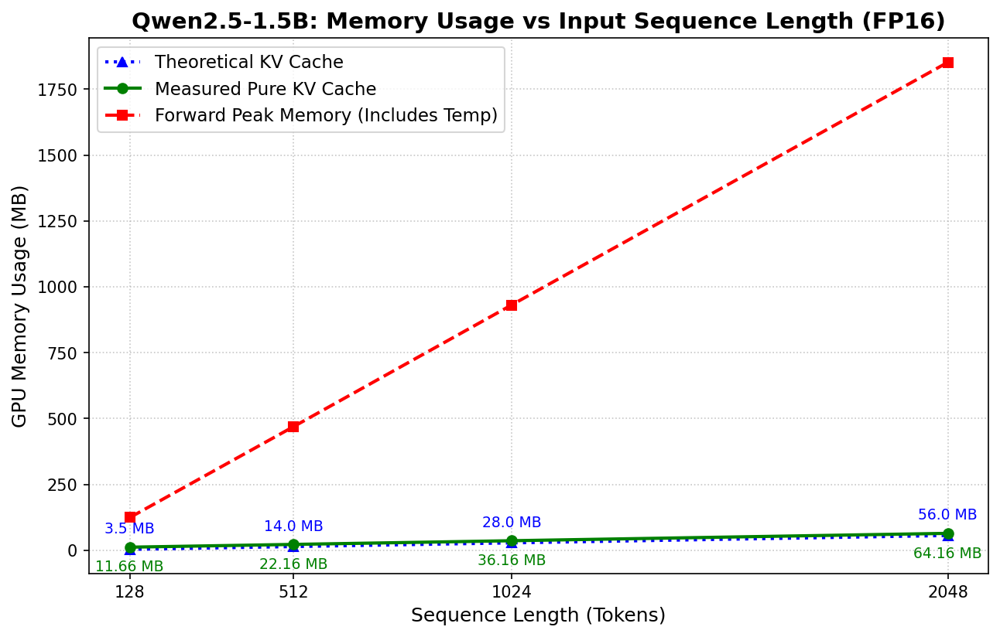
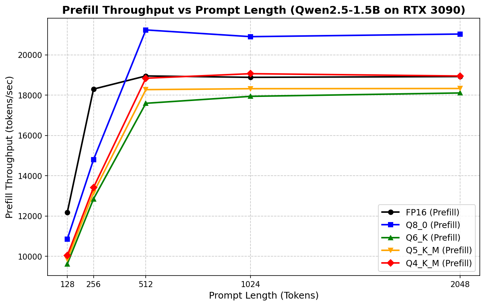

# 🚀 LLM Quantization & Deployment: End-to-Cloud Inference Optimization

**A Comprehensive Benchmark & Implementation of LLM Quantization (GGUF, AWQ) and Inference Frameworks (llama.cpp, vLLM, ONNX Runtime)**

---

## 📖 项目概览 (Project Overview)

本项目基于 **Qwen2.5-1.5B** 模型，从底层原理出发，完整实现了大语言模型在**端侧、云端、跨平台**三条核心推理链路的量化与部署。项目不仅包含严谨的 Benchmark 对比，还深入剖析了底层推理框架的性能瓶颈与调优策略，并结合信息熵理论探索了量化权重的无损压缩边界。

---

## 🏆 核心 Benchmark 数据 (Performance Benchmarks)

在控制变量的严格测试下（RTX 3090），各方案的实测性能表现如下：

| 部署方案 | 推理框架 / 格式 | 权重体积 | 生成速度 | 并发吞吐 (Batch=16) | 首字延迟 (TTFT) | 适用场景 |
| :--- | :--- | :--- | :--- | :--- | :--- | :--- |
| **FP16 (Baseline)** | PyTorch (原生) | 2.89 GB | 15.5 t/s | 550.5 t/s | - | 学术研究 / 训练 |
| **端侧量化** | llama.cpp (GGUF Q4_K_M) | **0.9 GB** | 185.7 t/s | 较弱 | 较高 | 手机 / 车机 / 离线设备 |
| **云端并发** | vLLM (AWQ W4A16 + Marlin) | 1.10 GB | **714.0 t/s** | **2902 t/s** | **2.93 ms** | Web API / 企业级服务 |
| **跨平台** | ONNX Runtime (ORT GenAI) | 2.9 GB | 116.1 t/s | 较弱 | - | Windows / Mac 轻量交付 |

---

## 🔬 核心工程结论 (Key Findings)

1. **长文本下的带宽红利**：在 Prefill 阶段，当 Prompt 长度超过 512 Token 时，Q4_K_M 模型因显著降低“内存墙（Memory Wall）”压力，计算核心利用率提升，吞吐量全面**反超原生 FP16**。
2. **云端内核调优的极限反杀**：在 vLLM 中开启 `awq_marlin` 汇编级内核与 `CUDA Graph`，抵消反量化与 CPU 调度开销。AWQ 生成速度达 **714 t/s**（反超 FP16 30%）；首字延迟低至 **2.93 ms**；节省的显存转化为额外的 KV Cache Block，**并发容量提升 38%**。
3. **跨平台交付的性能碾压**：将模型导出为静态计算图并通过 ORT 运行，消除 Python 动态图开销，速度达 **116 t/s**，是原生 PyTorch 的 **7.5 倍**。
4. **INT8 权重无损压缩的熵边界**：结合数据压缩背景，对 Q8_0 权重实测定长索引与静态 Huffman 编码。在计入分块索引开销的前提下，Huffman 编码仍实现 **3.36%** 的存储收益，论证了 INT8 权重的有效熵极限。

<table>
  <tr>
    <td align="center"><b>KV Cache 显存增长实测与理论对比</b></td>
    <td align="center"><b>端侧 Prefill 吞吐量：长文本下的带宽红利</b></td>
  </tr>
  <tr>
    <td></td>
    <td></td>
  </tr>
</table>

---

  <h2>👇 学习者与实习寻找者专区 (For Learners & Interns) 👇</h2>
  
<i>“半个月带你从调包侠入门模型压缩，直通 AI Infra 大厂面试”</i>

### 💡 这是一份怎样的学习指南？
如果你正在寻找 **AI Infra / 模型压缩** 方向的实习，或者单纯想搞懂大模型是怎么在手机上跑起来的，这份仓库就是为你准备的。我们不仅提供了全部跑通的代码，还附带了**详尽的踩坑记录**和**大厂面试绝杀话术**。

### 🗺️ 15 天打怪升级路线图

建议 `Fork` 或 `Star` 后跟着做。点击下方展开每周的硬核笔记（包含核心理论、代码和面试题）：

<b>🔥 第一周：大模型基础与显存探秘（Day 1-5）</b>

- [Day 1: 模型与张量基础](./notes/Day01_大模型基础与Token化.md) - *剖析参数量与显存计算法则*
- [Day 2: Transformer 与注意力机制](./notes/Day02_Transformer与注意力机制.md) - *手撸 Self-Attention 与因果掩码*
- [Day 3: KV Cache 原理与显存实测](./notes/Day03_KV_Cache与显存分析.md) - *手算 GQA 公式，探明显存杀手*
- [Day 4: 固定测试集与基线生成](./notes/Day04_基线生成与固定输入.md) - *建立标准化的 Baseline*
- [Day 5: 量化原理与对称量化](./notes/Day05_量化基础与对称非对称量化.md) - *手写代码，感受离群值的毁灭性打击*

<b>🔥 第二周：端侧部署与质量评估（Day 6-9）</b>

- [Day 6: llama.cpp 编译与 GGUF 转换](./notes/Day06_llama.cpp编译与GGUF转换.md) - *拥抱纯 C++ 推理引擎*
- [Day 7: GGUF 模型量化与质量评估](./notes/Day07_GGUF模型量化与质量评估.md) - *生成 Q4_K_M，验证反量化税*
- [Day 8: 可重复的性能基准](./notes/Day08_可重复的性能基准.md) - *揭秘长文本反转与带宽红利的底层逻辑*
- [Day 9: 输出质量评估](./notes/Day09_量化模型输出质量评估.md) - *PPL 困惑度与 JSON 下游任务双重考验*

<b>🔥 第三周：云端并发与 vLLM 极限调优（Day 10-12）</b>

- [Day 10: AWQ 量化与 vLLM 部署](./notes/Day10_AWQ量化与vLLM云端部署.md) - *进入高并发云端推理的大门*
- [Day 11: 极限调优与 TTFT 实测](./notes/Day11_vLLM极限调优与TTFT实测.md) - *引入交互体验核心指标*
- [Day 12: 底层加速与严格对比](./notes/Day12_vLLM底层加速调优与FP16-AWQ对比.md) - *Marlin 内核与 CUDA Graph 的魔法*

<b>🔥 第四周：跨平台交付与无损压缩进阶（Day 13-15）</b>

- [Day 13: ONNX 导出](./notes/Day13_ONNX_导出.md) - *打通静态计算图*
- [Day 14: ONNX 跨平台推理与性能对比](./notes/Day14_ONNX跨平台推理与性能对比.md) - *7.5 倍性能鸿沟的秘密*
- [Day 15: INT8 无损编码探索](./notes/Day15_INT8_无损编码.md) - *结合数据压缩背景，挖掘熵极限边界*

### 🎁 独家面试大杀器
项目笔记中散落着大量的 **“面试绝杀点”**（标注在每篇笔记末尾）。
- *“Prefill 和 Decode 哪个是算力瓶颈？”*
- *“为什么 AWQ 在云端速度能反超 FP16？”*
- *“你在项目中遇到的最大挑战是什么？”*
所有标准答案和底层逻辑，都在 `notes/` 中等你发掘。

---

<i>如果这个项目对你的学习或求职有帮助，请点一个 ⭐ Star，这是对作者最大的鼓励！</i>

