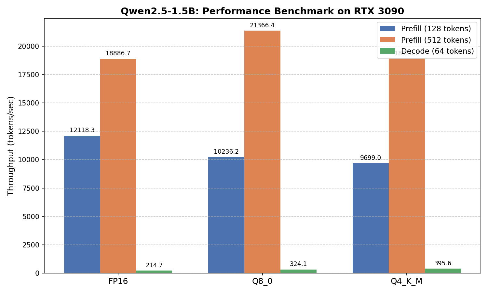
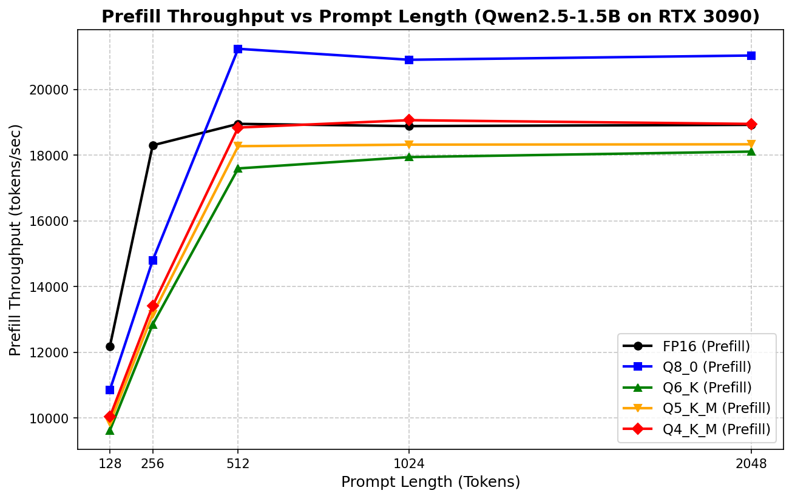

# Day 8: 建立可重复的性能基准与深度分析

## 一、 实验目的
为了全面评估量化对模型性能的影响，今天的任务分为两步：
1. **基础横向对比**：使用 `llama-bench` 比较 FP16、Q8_0、Q4_K_M 三档模型在标准长度下的吞吐量，验证量化的基础加速效果。
2. **深度纵向趋势**：引入更多量化档位（Q6_K, Q5_K_M）和更长的 Prompt 长度（128~2048），探明 GPU 算力瓶颈与显存带宽瓶颈的临界点。

## 二、 实验步骤与执行指令

### 1. 基础性能对比压测
测试 128、512 长度的 Prompt 预填充速度，以及 64 个 token 的生成速度。
```bash
./llama.cpp/build/bin/llama-bench \
  -m models/qwen-f16.gguf \
  -m models/qwen-q8.gguf \
  -m models/qwen-q4.gguf \
  -p 128,512 \
  -n 64 \
  -ngl 99 \
  -r 3 \
  -o json > results/3090_bench.json
```

### 2. 深度趋势压测
增加 Q6_K、Q5_K_M 模型，并拉长 Prompt 长度测试极限。
*(注：需提前用 `llama-quantize` 生成 q6 和 q5 模型)*
```bash
./llama.cpp/build/bin/llama-bench \
  -m models/qwen-f16.gguf \
  -m models/qwen-q8.gguf \
  -m models/qwen-q6.gguf \
  -m models/qwen-q5.gguf \
  -m models/qwen-q4.gguf \
  -p 128,256,512,1024,2048 \
  -n 64 \
  -ngl 99 \
  -r 3 \
  -o json > results/3090_bench_deep.json
```

### 3. 生成可视化图表
运行 Python 脚本，将 JSON 数据转换为柱状图和折线图：
```bash
python scripts/day08_plot_bench.py
python scripts/plot_bench_deep.py
```

---

## 三、 实验结果一：基础性能与双阶段分析



### 1. 数据对比
- **FP16**: Prefill(128) 12118 t/s | Prefill(512) 18886 t/s | Decode 214.7 t/s
- **Q8_0**: Prefill(128) 10236 t/s | Prefill(512) **21366 t/s** | Decode 324.1 t/s
- **Q4_K_M**: Prefill(128) 9699 t/s | Prefill(512) 18242 t/s | Decode **395.6 t/s**

### 2. 深度原理剖析
- **Decode（生成）阶段是绝对的“访存密集型”**：看绿色柱子，Q4_K_M 的生成速度（395.6）几乎是 FP16（214.7）的两倍。因为每生成一个 token，GPU 都要搬运全部权重。Q4 模型体积小，显存带宽压力锐减，速度自然翻倍。
- **Prefill（预填充）阶段的“反量化税”**：在 128 长度时，FP16 最快。因为量化模型（Q8/Q4）必须先执行反量化（Int 转 Float）再计算，这增加了算力开销。
- **512 长度下的 Q8_0 反超**：当 Prompt 变长，带宽压力增大。Q8_0 读取权重只需一半带宽，省下的时间盖过了反量化开销，从而反超 FP16（21366 > 18886）。

---

## 四、 实验结果二：长文本趋势与极限博弈



### 核心发现 1：算力预热与稳态（128~512 阶段）
所有曲线在 128 到 512 阶段都呈现陡峭上升。因为短 Prompt 无法填满 GPU 的计算核心（SM）。随着长度增加，矩阵乘法规模变大，算力利用率被打满，吞吐率迅速攀升；超过 512 后，系统达到稳态，吞吐量趋于平缓。

### 核心发现 2：长文本下的“性能反杀”
- 在 128 短文本时，FP16（黑线）速度最快。
- 当序列长度达到 512 及以上时，**Q8_0（蓝线）和 Q4_K_M（红线）全面反超 FP16**。长文本下显存带宽成为绝对瓶颈，量化模型节省的带宽时间远超反量化开销。工程上，长文本处理（如文档阅读）用 Q8_0 是极佳选择。

### 核心发现 3：Q6_K 的尴尬定位
图表显示，Q6_K（绿线）的吞吐量长期垫底，甚至不如 Q5 和 Q4。这是因为 Q6_K 的数据块结构极度复杂，导致极高的“反量化计算税”。在 GPU 平台上，**量化档位并不是位数越高就越快，Q6_K 往往是个“费力不讨好”的档位**。

---

## 五、 工程决策结论（面试大招）
> “通过这两次基准测试，我明确了端侧部署的选型逻辑：
> 1. 如果是**长文本摘要/阅读**（重 Prefill），首选 **Q8_0**，因为它能抗住带宽压力，吞吐量最高且精度无损。
> 2. 如果是**日常对话/边缘设备**（重 Decode），首选 **Q4_K_M**，0.9GB 的体积能提供近乎翻倍的极速生成体验。
> 3. **避开 Q6_K**，在 GPU 平台上其反量化开销过大，性价比极低。
> 优秀的 Infra 工程师，必须通过真实压测来指导模型选型，而不是盲目追求低比特。”

---
> **代码与结果入口**：
> - 基础柱状图代码：[day08_plot_bench.py](../scripts/plot_bench.py) | 原始数据：[3090_bench.json](../results/3090_bench.json)
> - 深度折线图代码：[plot_bench_deep.py](../scripts/plot_bench_deep.py) | 原始数据：[3090_bench_deep.json](../results/3090_bench_deep.json)
> - 结果图片：[bench_3090_bar.png](../results/bench_3090_bar.png) | [bench_prefill_curve.png](../results/bench_prefill_curve.png)